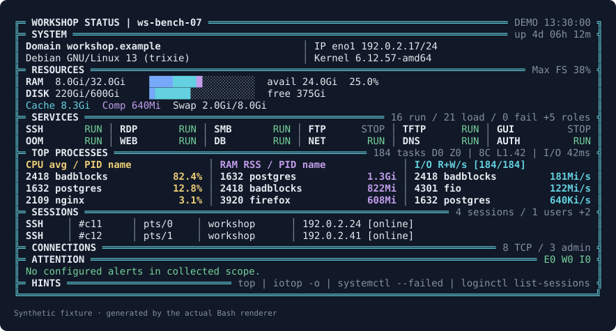

# motd

A small configurator for Linux messages of the day. Start from a preset, change the sections and presentation, then generate a standalone Bash script or a static prelogin notice.

The configurator uses **Python 3.11 or later and the standard library**. The generated Bash dashboard does not need Python, TOML, this repository, or the configurator at login. Its inherited runtime requires **Linux/procfs, Bash 4.3+, and GNU `timeout`**, plus the commands used by enabled collectors.

This is the initial v0.1 development implementation. Workshop and home-lab displays use the same runtime; their configuration supplies the differences. A release channel, package repository, and cross-platform support are not part of this version.

## Start here

Download `motd.py` and run:

```sh
python3 motd.py
```

Download-and-run convenience command (requires Python 3.11+):

```sh
curl -fL -o motd.py https://raw.githubusercontent.com/Julesc013/motd/main/motd.py && python3 motd.py
```

The download is a readable local file. You can inspect it before running the
second command. Pin `main` to a reviewed commit SHA when deploying an exact
version. The wizard requires a terminal; piping source into Python would consume
the same standard input it needs for questions.

The opening menu asks what you want to do: **create, install, reconfigure, inspect/audit, repair, uninstall, or rollback**. `python3 motd.py wizard` opens the same workflow. For all command-line options:

```sh
python3 motd.py --help
```

For a quick command-line workflow:

```sh
python3 motd.py preview --preset workshop
python3 motd.py build --preset workshop --output ./workshop.bash --save-config ./workshop.toml
python3 motd.py plan --config ./workshop.toml --target shell --scope user --audience ssh --name workshop
python3 motd.py install --config ./workshop.toml --target shell --scope user --audience ssh --name workshop
```

Preview uses demonstration data by default. Add `--live` to collect local information; both modes suppress before/after commands for generated recipes. A recognized imported recipe is regenerated for preview. Explicit `--live --trust-artifact` execution of an opaque script can have that script's normal side effects. Installation presents the plan and asks before applying it. `--yes` applies a noninteractive installation, so review `plan` first when automating.

Presets are `workshop`, `home-lab`, and `public-console`. You can instead use `--config FILE` or recover a generated Bash script's configuration with `--artifact FILE`. Keep the configuration and generated output; installation transactions also archive them for inspection and recovery. Choose an existing parent directory for generated or installed files.

## Copyable examples

The files in [examples](examples/README.md) are complete portable outputs. Their
recipes are in [presets](presets). Generate once, then copy the Bash file by USB,
SSH or your existing deployment tool. Only attaching it to login needs installation.

The following gallery is rendered from synthetic fixture data by the actual engine:




Ordinary configuration is data. Optional commands are explicit argument arrays; shell expressions require an explicitly chosen shell invocation. Inspecting an existing script does not execute it.

## Choose a destination

| Target and scope | Output and audience |
|---|---|
| `--target shell --scope user` | A Bash dashboard for the selected user's eligible interactive terminal sessions. |
| `--target shell --scope system` | A host-managed Bash login hook; the display runs with the session user's permissions. |
| `issue` | A static public notice for the console login screen used by agetty. |
| `ssh-banner` | A static public notice for OpenSSH before authentication. |

For shell output, `--audience all|ssh|local` selects eligible sessions. The system default uses `/etc/profile.d` for login shells; non-login system Bash integration needs an explicitly selected `--shell-file` read by those shells. The last two targets use static text, do not run dashboard hooks, and do not refresh at each connection. Generated issue notices escape literal backslashes; imported static artifacts are already serialized outputs and retain their existing escapes. See [installation and target contracts](docs/install.md) before changing system login files.

## Existing scripts and later changes

A Bash output generated by this project carries metadata from which the configurator can recover its configuration:

```sh
python3 motd.py config --artifact ./workshop.bash --output ./recovered.toml
```

Static issue and SSH banner files contain only public text; retain their TOML recipe or installation archive to reconfigure them. Installing an existing Bash file's exact bytes requires `--trust-artifact`, even when it carries metadata. An arbitrary Bash script has no editable model. The import records a SHA-256 fingerprint of the original bytes; it does not guess settings or establish who wrote the script. Rewritten TOML preserves supported settings, not the original comments or formatting.

Reconfigure managed outputs through the configurator. `repair --name NAME` uses the current installation manifest across upgrades and restores missing owned files while preserving modified ones. Rollback reverses a completed transaction only when later ownership and file changes allow it; recovery reverses an interrupted apply. Review each plan and keep unrelated files outside the installation's ownership. See the [recovery limits](docs/install.md#recovery-boundaries) for what the archive preserves.

## Project layout and decisions

`runtime/motd.bash` is the canonical dashboard engine. The downloadable `motd.py` embeds that runtime so users need only one configurator file. TOML presets describe displays without creating separate workshop and home-lab engines. Generated output is an artifact, not a second source tree to maintain by hand.

`reference/` preserves the original workshop and home-lab scripts, workshop guide, verification record, and provenance. Those imports provide history and comparison material; changes belong in the canonical runtime and configurator.

- [Design and language choice](docs/design.md)
- [Configuration and before/after commands](docs/configuration.md)
- [Installation, imports, and recovery](docs/install.md)
- [v0.1 scope and acceptance contract](specs/v0.1.md)

Zsh integration, PowerShell, Windows, DOS, native packages, a browser designer, and a plugin marketplace are future ideas, not supported features.

## Verification

The initial local verification ran **84 tests: 83 passed and one root-only
numeric-ownership test was skipped**. Tests cover configuration recovery, Bash
quoting, hooks, adaptive fixtures, a PTY wizard flow, noninteractive guards,
installation/removal, undo/redo and injected interruption recovery.

The [verification record](build/verification.json) pins the tested sources and
states the limits. Real SSH/PAM/agetty installation and root-only ownership
restoration still require verification on the intended hosts. Run the suite with:

```sh
python3 tools/embed_runtime.py --check
python3 -m unittest discover -s tests -v
```

## License

A license has not yet been selected. Resolve the project license and the provenance of included material before assigning redistribution terms or publishing third-party redistribution instructions.
