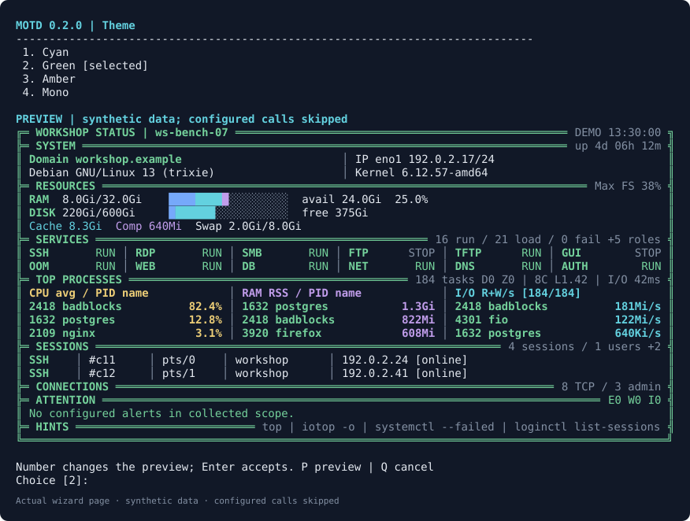
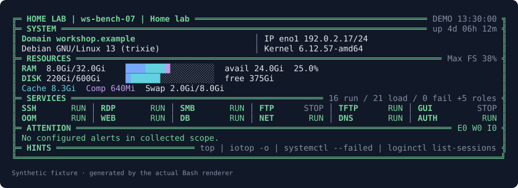

# motd

A small configurator for messages of the day. Start from a preset, preview the sections and presentation, then generate a standalone shell script or a static login notice.

The configurator needs **Python 3.8 or later**. It contains a readable, licensed TOML parser for Python versions before 3.11; no package download is needed. Generation, inspection and previews are portable across Linux, macOS and Windows. Generated displays do not need Python, TOML, this repository, or the configurator at login. Choose **Bash, Zsh, portable sh, fish, native PowerShell or a CMD launcher**, or export static text. Their prerequisites and collector coverage differ; see the [compatibility guide](docs/compatibility.md).

Version 0.4 adds five different presentations, independent spacing and detail preferences, section priority, more approachable wizard controls, older Python support and create-only Windows export. Workshop and home-lab remain configurations over shared collectors. Automatic login installation remains Linux-specific; generating a compatible file does not certify every host or configure its login service. Exact executed engines and unverified targets are listed separately.

## Start here

Download `motd.py` and run:

```sh
python3 motd.py
```

Download-and-run convenience command (requires Python 3.8+):

```sh
curl -fL -o motd.py https://raw.githubusercontent.com/Julesc013/motd/main/motd.py && python3 motd.py
```

The download is a readable local file. You can inspect it before running the
second command. Pin `main` to a reviewed commit SHA when deploying an exact
version. The wizard requires a terminal; piping source into Python would consume
the same standard input it needs for questions.

The opening menu asks what you want to do: **create, install, reconfigure, inspect/audit, repair, recover, uninstall, or rollback**. `python3 motd.py wizard` opens the same workflow.

On Windows, use `python motd.py` with the same file. Hosts without the Linux
installer show create/open/export actions, rather than offering unsupported
installation choices. Windows exports create new files and a hash manifest;
they do not overwrite existing files or claim a Linux-style rollback journal.

On a suitable terminal, the wizard uses successive screens with numbered choices. Destination, design, readability, sections, content and calls are grouped into pages. Type a number and Enter, or use Up/Down and Enter in selection menus. `?` explains choices and controls. Appearance choices show a synthetic preview; you can go back, request a full preview, review the installation plan, save/build, or cancel. Choosing options does not install anything.

## Choose a presentation

| Design | Presentation |
|---|---|
| `classic` | The original continuous frame and compact information grid. |
| `cards` | Separate panels with clear boundaries and breathing room. |
| `ledger` | Open section labels and aligned observations without an outer box. |
| `briefing` | Attention first, then short headings with optional explanatory detail. |
| `dashboard` | A metric summary with paired cards on wide terminals and stacked cards when narrow. |

The [design sampler](examples/designs/README.md) shows actual generated output at
the four requested terminal sizes. Its [local filterable index](examples/designs/index.html)
also includes density/detail contrasts. These choices reuse collection code.

```sh
python3 motd.py preview --preset workshop --design dashboard --width 80 --rows 25
python3 motd.py build --preset home-lab --design cards --density comfortable \
  --detail brief --section-detail resources=full --color-emphasis quiet \
  --padding 2 --section-gap 1 --output ./home-lab.bash --save-config ./home-lab.toml
```

Density controls spacing bias; detail controls the requested amount of
information. Padding, blank section gaps, colour emphasis, visible sections,
display order and scarce-space priority are separate settings. The terminal
budget remains a hard limit, with named omissions rather than cropped panels.
Existing recipes keep `classic` unless a different design is selected.

Select the presentation explicitly when needed:

```sh
python3 motd.py wizard --ui screen
python3 motd.py wizard --ui line
```

The default `--ui auto` selects the screen interface for a compatible terminal at least **40 columns by 18 rows**, with a line-mode fallback. No curses package or GUI toolkit is required. For command-line options:

```sh
python3 motd.py --help
```

This is a page rendered by the actual wizard with synthetic fixture data:



### A fixed control area and a resizing preview

The wizard reserves **10 rows** for its title, five question/choice rows, status,
navigation, answer field and preview label. Longer menus are paginated; use `[` / `]`
to see more choices. The preview starts on row 11 and is rendered for the current
terminal dimensions. On Linux/POSIX, resizing redraws it while you are typing;
your unfinished answer is retained. The preview geometry is temporary and does
not rewrite the recipe's saved width/row settings.

The native Windows input path checks the console dimensions while reading keys.
It enables VT output only on a compatible console and restores the original
console mode on exit; old or redirected hosts use line mode. Ordinary choices
update changed rows in one buffered write, avoiding a whole-screen clear for
each selection. Cold preview startup still depends on the selected interpreter.

| Terminal | Control rows | Preview area |
|---|---:|---|
| 40×25 | 10 | 40×15 |
| 40×50 | 10 | 40×40 |
| 80×25 | 10 | 80×15 |
| 80×50 | 10 | 80×40 |

The renderers reduce detail and omit whole sections when a short viewport needs
it, keeping complete borders and a visible omitted-section count. Normal runtime
overrides accept 8–200 rows and 40–240 columns. The preview uses those limits in
unusually large windows. If the window becomes too small during an answer, the
answer remains intact and the full screen returns when the window is enlarged.

Type `H` then Enter to include **sample before/after output**, or hide it again.
Fastfetch is hidden by default and has a clearly synthetic built-in sample.
Literal echo/printf examples can be displayed, and any command can supply a
`preview_text` field. Unknown commands show a missing-sample placeholder.
**No configured command executes for this preview.** `J`/`K` scroll a sample
sequence longer than the preview area; `P` opens the dedicated preview page.
See [sample configuration](docs/configuration.md#previewing-beforeafter-output).

Five [wizard PNG views](examples/wizard-manifest.json) accompany the dashboard
gallery: the four terminal sizes, plus [sample before/after calls](examples/wizard-call-samples-80x50.png).
Examples include [40×25](examples/wizard-40x25.png) and [80×50](examples/wizard-80x50.png).

For a quick command-line workflow:

```sh
python3 motd.py preview --preset workshop
python3 motd.py build --preset workshop --output ./workshop.bash --save-config ./workshop.toml
python3 motd.py plan --config ./workshop.toml --target shell --scope user --audience ssh --name workshop
python3 motd.py install --config ./workshop.toml --target shell --scope user --audience ssh --name workshop
```

Preview uses demonstration data by default. Add `--live` to collect local information; both modes suppress before/after commands for generated recipes. A recognized imported recipe is regenerated for preview. Explicit `--live --trust-artifact` execution of an opaque script can have that script's normal side effects. Installation presents the plan and asks before applying it. `--yes` applies a noninteractive installation, so review `plan` first when automating.

Presets are `workshop`, `home-lab`, and `public-console`. You can instead use `--config FILE` or recover a generated script's configuration with `--artifact FILE`. Keep the configuration and generated output; installation transactions also archive them for inspection and recovery. Choose an existing parent directory for generated or installed files.

## Choose an interpreter

```sh
python3 motd.py build --preset workshop --shell bash --output ./workshop.bash
python3 motd.py build --preset workshop --shell zsh --output ./workshop.zsh
python3 motd.py build --preset workshop --shell sh --output ./workshop.sh
python3 motd.py build --preset workshop --shell fish --output ./workshop.fish
python3 motd.py build --preset workshop --shell powershell --output ./workshop.ps1
python3 motd.py build --preset workshop --shell cmd --output ./workshop.cmd
python3 motd.py build --preset public-console --target batch-text --output ./notice.cmd
```

| Output | Behaviour |
|---|---|
| Bash | One file selects the enhanced Linux renderer on Bash 4.3+, or a portable renderer on older Bash and other Unix systems. No destination-side Python is needed. |
| Zsh | Standalone entry point selects the same Unix renderer through `/bin/bash`, with `/bin/sh` when Bash is absent. Collector code is shared rather than duplicated in Zsh syntax. |
| sh | Portable renderer with the same nine section IDs, adaptive layout, themes and hooks. Linux and Darwin/BSD collectors use available local interfaces; unavailable measurements are labelled. |
| fish | One-file entry point passes the shared portable Unix core to `/bin/sh`; no duplicated fish collector or temporary script. Very large payloads must use direct sh output. |
| PowerShell | Native `.ps1` renderer using PowerShell 1-era literals and feature detection. Windows PowerShell 1–5 and PowerShell 6–7 are compatibility targets; exact engine/OS verification is recorded separately. |
| cmd | One-file CMD launcher containing the readable native PowerShell core. Requires an installed PowerShell with `ScriptBlock.Create` (PowerShell 2+ target). |
| batch-text | Plain ASCII Windows NT-family batch notice using built-in commands only; no PowerShell or live collectors. It is not a COMMAND.COM/DOS certification. |

Generate on a suitable machine and copy the file to a destination that lacks Python 3.8. A targeted language version is distinct from a verified OS/version combination; the [compatibility matrix](docs/compatibility.md) and test records state that distinction.

## Copyable examples

The files in [examples](examples/README.md) are complete portable outputs. Their
recipes are in [presets](presets). Generate once, then copy the output by USB,
SSH or your existing deployment tool. Only attaching it to login needs installation.

The following gallery is rendered from synthetic fixture data by the actual engine:




The [PNG gallery](examples/gallery/README.md) covers **40×25, 40×50, 80×25 and 80×50** terminals across both dashboard presets, four output routes, four themes, ASCII/Unicode and colour/plain modes. Open `examples/gallery/index.html` locally for filters. Each capture retains its command, recipe, raw ANSI output, interpreter version and hashes. PNG optimization is lossless; a wider or taller screenshot comes from a newly executed layout, not resizing a smaller output. See [gallery reproduction](docs/gallery.md).

Ordinary configuration is data. Optional commands are explicit argument arrays; shell expressions require an explicitly chosen shell invocation. Inspecting an existing script does not execute it.

## Choose a destination

| Target and scope | Output and audience |
|---|---|
| `--target shell --scope user` | A Bash, Zsh, fish or sh display for the selected user's eligible interactive terminal sessions on Linux. |
| `--target shell --scope system` | A host-managed Linux shell hook; the display runs with the session user's permissions. Zsh and nonstandard startup routes need an explicit appropriate file. |
| `issue` | A static public notice for the console login screen used by agetty. |
| `ssh-banner` | A static public notice for OpenSSH before authentication. |
| `text` | Generic static text for a deliberately selected consumer or destination. |
| `batch-text` | A plain ASCII CMD notice. No executable before/after calls or live observations. |

For shell output, `--audience all|ssh|local` selects eligible sessions. `local` means SSH markers are absent; it does not prove a physical console. The Bash system default uses `/etc/profile.d` for login shells; other startup routes need a host-appropriate `--shell-file`. Static targets do not run hooks or refresh on each connection. Generated issue notices escape agetty backslashes; generic text has no consumer-specific escaping. Imported static artifacts retain their existing bytes. See [installation and target contracts](docs/install.md).

## Existing scripts and later changes

A shell output generated by this project carries metadata from which the configurator can recover its configuration:

```sh
python3 motd.py config --artifact ./workshop.bash --output ./recovered.toml
```

Static outputs do not embed a recoverable recipe; retain their TOML recipe or archive to reconfigure them. Installing an existing executable file's exact bytes requires `--trust-artifact`, even when it carries metadata. An arbitrary executable also requires an explicit `--shell`; its language is never guessed. The import records a SHA-256 fingerprint; it does not establish authorship. Rewritten TOML preserves supported settings, not original comments or formatting.

Reconfigure managed outputs through the configurator. `repair --name NAME` uses the current installation manifest across upgrades and restores missing owned files while preserving modified ones. Rollback reverses a completed transaction only when later ownership and file changes allow it; recovery reverses an interrupted apply. Review each plan and keep unrelated files outside the installation's ownership. See the [recovery limits](docs/install.md#recovery-boundaries) for what the archive preserves.

## Project layout and decisions

`runtime/` holds canonical Bash, portable sh and PowerShell templates plus one
shared POSIX presentation engine. `vendor/tomli/` retains the pinned parser and
its licence. The downloadable `motd.py` embeds readable source so users need one
configurator file. TOML recipes select content and appearance; generated
examples are rebuilt from the canonical sources.

`reference/` preserves the original workshop and home-lab scripts, workshop guide, verification record, and provenance. Those imports provide history and comparison material; changes belong in the canonical runtime and configurator.

- [Design and language choice](docs/design.md)
- [Configuration and before/after commands](docs/configuration.md)
- [Installation, imports, and recovery](docs/install.md)
- [Compatibility and login surfaces](docs/compatibility.md)
- [Current shell, surface and wizard specification](specs/compatibility.md)
- [Version 0.4 presentation and portability contract](specs/v0.4.md)
- [Discussion, implementation and architecture audit](docs/audit-2026-11-17.md)
- [Roadmap](ROADMAP.md) and [concrete task list](TODO.md)
- [Historical v0.1 acceptance contract](specs/v0.1.md)

BusyBox/BSD getty adapters, PAM integration, Windows installation, RDP desktop-start notices, and DOS/OS/2 wrappers are specified separately as future work. Existing SSH/Telnet terminal sessions can use an eligible shell hook; an RDP desktop does not provide a generic text-banner destination.

## Verification

Tests cover configuration recovery, literal quoting, interpreter demonstrations,
hooks, adaptive fixtures, wizard flows, noninteractive guards, installation/removal,
undo/redo and injected interruption recovery. A skipped optional interpreter test
does not establish support for that interpreter.

The [verification records](build/) and the current GitHub Actions run identify
tested sources and limits. Real SSH/PAM/agetty installation, root-only ownership
restoration and older OS combinations need their own host evidence. Run:

```sh
python3 tools/embed_runtime.py --check
python3 tools/embed_toml.py --check
python3 -m pip install -r requirements-dev.txt
python3 -m unittest discover -s tests -v
```

## License

A license has not yet been selected. Resolve the project license and the provenance of included material before assigning redistribution terms or publishing third-party redistribution instructions.
